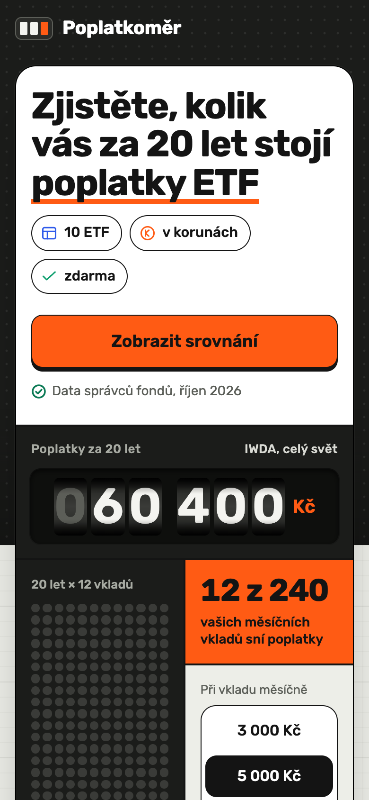
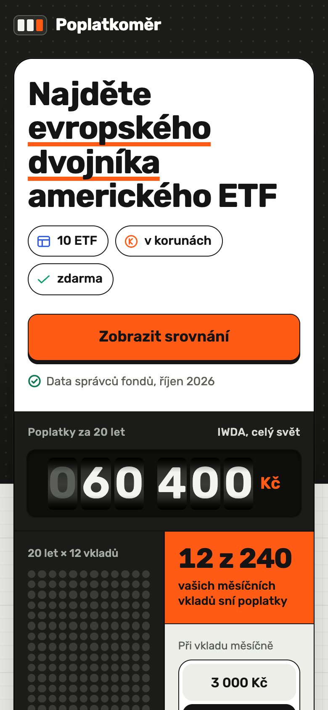
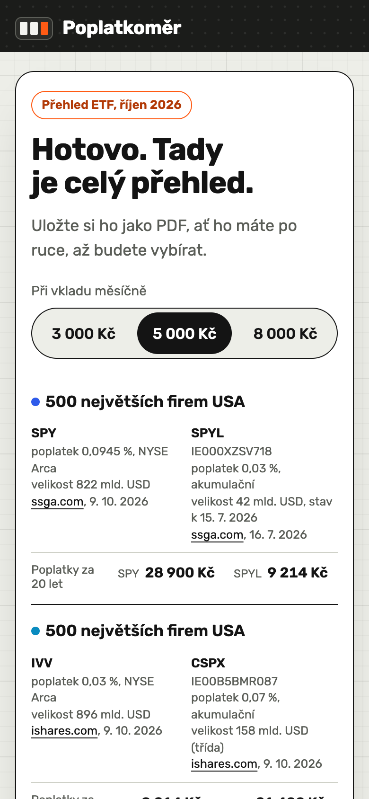
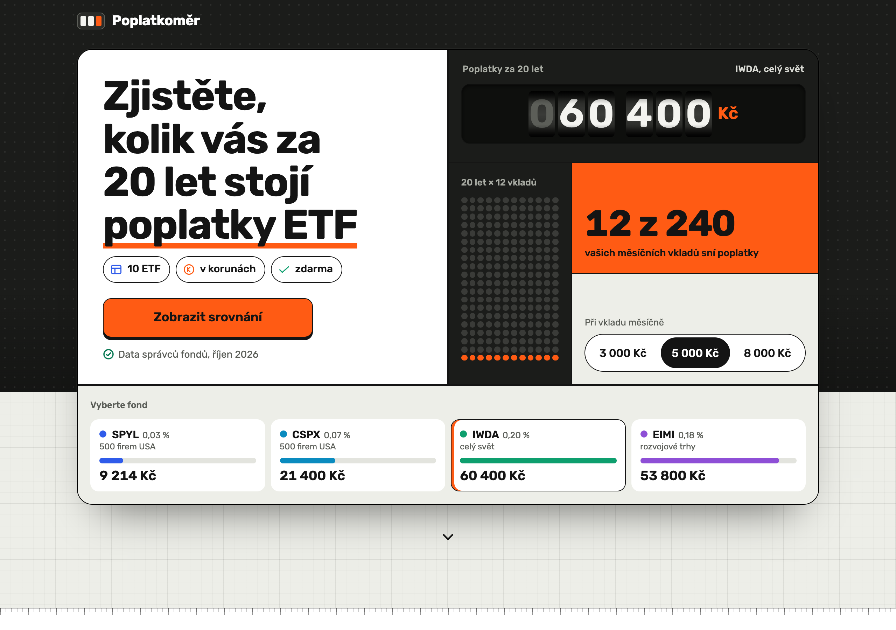

# Poplatkoměr: konverzní landing page (lead magnet)

Srovnání ETF obchodovaných na NYSE pro českého drobného investora z mobilní reklamy. „Poplatkoměr“ je vymyšlený pracovní název. Statický web (bez build kroku, bez externích požadavků) + 2 Vercel funkce.

## Rychlý start
| Co | Příkaz |
|---|---|
| Nasazení | `npx vercel --prod` v této složce, nebo import repozitáře GitHub ve Vercelu (Framework: Other, bez build příkazu). Volitelně `LEAD_WEBHOOK_URL`, `EVENT_WEBHOOK_URL`. |
| Lokálně | `npm run dev` → http://127.0.0.1:4310 (mini server se stejnými hlavičkami CSP jako `vercel.json` a s `/api/*`) |
| Testy (model, API, Python) | `npm test` (Node ≥ 18, Python 3) |
| E2E v prohlížeči | `npm install`, pak `npx playwright-core@1.63.0 install chromium` (nebo `CHROMIUM_PATH=/cesta/k/chrome`), pak `npm run test:e2e` → screenshoty a PDF v `tests/out/` |
| Reklamy A a B | `npm run ads` → `ads/export/` (kreativa 1080 × 1350 a náhled příspěvku); náhled v prohlížeči `npm run dev` → `/ads/reklama.html?v=a` nebo `?v=b` |
| Varianty | `/?v=a` (cena poplatků, výchozí), `/?v=b` (dostupnost) |

```
index.html  styles.css  app.js  calc.js         stránka, logika, model (UMD, sdílený s testy)
data/etf_data.json  data/tax_model.json         data se zdroji; výsledky daňového modelu
tax_model.py                                     Python model, generuje/ověřuje tax_model.json
api/subscribe.js  api/event.js  vercel.json      funkce (lead, události) a hlavičky
test_calc.js  test_api.js  tests/e2e.js  tests/dev.js  tests/ads.js
ads/reklama.html  ads/ads.js  ads/ads.css  ads/export/*.png   reklamy A a B (texty podle zadání, čísla z dat)
fonts/rubik-*.woff2 (+ OFL licence)              písmo lokálně, bez externích požadavků
```
`.vercelignore` vynechává z nasazení `tests/`, `ads/`, `docs/`, `tax_model.py` a `node_modules`.

## Náhledy
| Mobil, varianta A | Mobil, varianta B | Po odeslání (mobil) |
|---|---|---|
|  |  |  |



Reklamy: [A](ads/export/reklama-a-nahled-prispevku.png), [B](ads/export/reklama-b-nahled-prispevku.png) (kreativy 1080 × 1350 v `ads/export/`).

## 1. Publikum a nabídka
- **Kdo:** Češi 25–40 let, hrubý příjem cca 50–75 tis. Kč/měsíc (ČSÚ: průměrná hrubá mzda Q2 2026 51 966 Kč, Praha 66 459 Kč). Míra úspor kolem 19 %. Měsíční vklad 3 000 / 5 000 / 8 000 Kč je **předpoklad**, ne ověřený údaj. Hlavní zařízení: mobil. Začátečník v ETF, nezná tickery ani zkratky. Stránka se ptá na měsíční vklad, ne na příjem.
- **Co dostane za kontakt:** „Přehled ETF“: 10 fondů (5 amerických z NYSE Arca + 5 evropských dvojníků UCITS): poplatek, velikost, akumulační/distribuční, ISIN, datum a odkaz na zdroj u každého údaje; dopad poplatků a daní za 20 let v Kč pro zvolenou částku; zjištění o typu fondu (41–81 tis. Kč vs. ≤ 27 tis. Kč rozdílu v poplatcích); kontrolní seznam před koupí (5 bodů); uložení jako PDF.
- **Kdy žádáme kontakt:** až po ukázce hodnoty: měřák a sloupce v hero, graf růstu poplatku, náhled tabulky (3 páry vidět, 2 rozmazané, zóna zámku s CTA). Formulář je jediný, na konci stránky, jedno pole (e-mail), bez marketingového checkboxu (GDPR: souhlas nesmí být podmínkou bezplatného přehledu).
- **Po odeslání:** celý přehled se ukáže hned na stránce; hero, „Co dostanete“, „Pro koho“, graf růstu, náhled, kvíz, finální formulář a lepicí lišta se skryjí. **E-mailem se nic neposílá** (ESP není připojen), proto to stránka nikde neslibuje.

## 2. Dvě reklamy a první obrazovka
| | A: cena poplatků | B: dostupnost |
|---|---|---|
| Hlavní text | Kolik stojí poplatky ETF za 20 let? Spočítali jsme to v korunách pro 10 fondů.* Ilustrace, ne doporučení. | VOO a SPY si drobný investor z Česka obvykle nekoupí. Jaký je jejich evropský dvojník a kolik stojí? Informativní přehled. |
| Titulek | Kolik stojí poplatky ETF za 20 let? | Americké ETF a jejich evropští dvojníci |
| Popis | Data ze stránek správců fondů | Poplatky u 5 párů fondů |
| CTA | Zjistit více | Zobrazit srovnání |
| URL | `/?v=a&utm_source=meta&utm_medium=paid_social&utm_campaign=poplatky_etf_2026_10&utm_content=a_poplatky` | `/?v=b&utm_source=meta&utm_medium=paid_social&utm_campaign=poplatky_etf_2026_10&utm_content=b_dostupnost` |

\* Prostřední věta reklamy A doplněna při finalizaci (v zadání byla vynechávka „…“); ke schválení.

**Kreativy (formát 4:5, 1080 × 1350, mobilní feed):** `ads/export/reklama-a-1080x1350.png`, `ads/export/reklama-b-1080x1350.png` + náhledy příspěvku (text nad obrázkem, titulek, popis, CTA). Vizuál navazuje na první obrazovku, aby klik nepůsobil jako změna značky:
- **A:** otázka „Kolik stojí poplatky ETF za 20 let?“, měřák s číselníky (IWDA, 60 400 Kč při 5 000 Kč/měs.), waffle „12 z 240 vašich měsíčních vkladů sní poplatky“. Po kliku stejný měřák a stejné číslo v hero.
- **B:** „Americké ETF a jejich evropští dvojníci“, tři páry SPY → SPYL, IVV → CSPX, URTH → IWDA s poplatky; americký fond šrafovaně („v EU obvykle nedostupný“), dvojník bíle. Po kliku stejné páry v hero varianty B.
- Na obou: „Ilustrace / Informativní přehled, ne doporučení“, předpoklady výpočtu, „Minulá výkonnost nezaručuje budoucí výsledky“ (A), „Dostupnost ověřte u svého zprostředkovatele“ (B), zdroj a datum dat. Bez strašení a bez slibů výnosu. Čísla se počítají z `data/*.json` přes `calc.js`; `npm run ads` ověří, že číselníky odpovídají modelu, že se vše (včetně upozornění) vejde do 1080 × 1350 a že stránka nemá chyby CSP.

| Slib reklamy → první obrazovka | A | B |
|---|---|---|
| H1 (klíčová slova podtržená) | Zjistěte, kolik vás za 20 let stojí **poplatky ETF** | Najděte **evropského dvojníka** amerického ETF |
| Měřák (výchozí fond) | IWDA: poplatky za 20 let, „12 z 240 vašich měsíčních vkladů sní poplatky“ (při 5 000 Kč) | stejné |
| Fondy pod měřákem | 4 evropské fondy koupitelné v EU: SPYL, CSPX, IWDA, EIMI, s krátkým indexem („500 firem USA“, „celý svět“, „rozvojové trhy“) | 3 páry SPY\|SPYL, IVV\|CSPX, URTH\|IWDA; americký šrafovaně + legenda „šrafované = v EU obvykle nedostupný“ |

Společné: štítky „10 ETF“, „v korunách“, „zdarma“; tlačítko „Zobrazit srovnání“ (kotva k formuláři, nastaví fokus do pole); „Data správců fondů, říjen 2026“; volba 3 000 / 5 000 / 8 000 Kč. V hero jsou jen údaje ověřené u správce (ne VOO/VUAA).

## 3. Proč tento úhel
Zadání chce ETF z NYSE. Americké ETF nemají PRIIPs KID, takže je brokeři v EU drobným klientům obvykle neprodají; profesionální status pro tuto skupinu nepřipadá v úvahu. Proto stojí každý americký fond (VOO, SPY, IVV, URTH, IEMG, všechny NYSE Arca) vedle irského UCITS dvojníka na stejný index. QQQ vyřazen (Nasdaq, ne NYSE).
Úhel „inflace žere úspory“ je slabý (spořicí účty ~2,5 % vs. CPI ~2,0 %), proto hlavní úhel = **poplatky**, vedlejší (B) = **dostupnost**.
Hlavní zjištění modelu: **typ fondu (akumulační/distribuční) a W-8BEN ovlivní 20letý výsledek víc než rozdíl v TER.** Při 5 000 Kč/měs. je rozdíl akum./dist. při stejném poplatku cca 41–81 tis. Kč, největší rozdíl v poplatcích mezi americkým a evropským fondem cca 27 tis. Kč. Nejlevnější S&P 500 UCITS: SPYL (0,03 %).
Nemodelováno: americká dědická daň (US-situs estate tax nad 60 tis. USD pro nerezidenty), kurzové poplatky brokera, daň z prodeje, pohyb kurzu.

## 4. Pořadí sekcí a proč
1. **Hero („přístrojová deska“):** jen název bez menu; H1 navazuje na reklamu; hned vidět hodnota (měřák, „12 z 240“, sloupce fondů), dřív než po čemkoli žádáme. Bez pole e-mail, jen tlačítko s kotvou. Šipka dolů jako náznak pokračování.
2. **Co dostanete:** náhled listu přehledu s očíslovanými značkami 1–3 + tři body + druhé CTA. Kdo je přesvědčený po hero, má hned cestu dál.
3. **Pro koho to je:** čtyři bolesti jazykem začátečníka (s ikonami), každá s jednou větou odpovědi.
4. **Proč malé procento za 20 let tolik stojí:** graf kumulovaných poplatků 4 evropských fondů s posuvníkem roku. Vysvětlí mechanismus (poplatek z rostoucí částky) dřív, než návštěvník uvidí tabulku.
5. **Takhle vypadá přehled:** náhled 3 párů, 2 rozmazané, CTA „Zobrazit zbylé 2 páry a daně“. Hlavní spouštěč konverze. Plně ověřené páry nahoře, VOO/VUAA poslední. Na mobilu bez vodorovného scrollu.
6. **Kvíz „Tři otázky“:** tři časté omyly začátečníka (VOO lze koupit; 0,20 % jsou drobné; nejdůležitější je poplatek). Okamžitá odpověď, skóre a CTA. Zdůvodnění a rizika: kap. 9 (hypotéza 4).
7. **Jak data zpracováváme:** recenze ani počty stažení nemáme a vymýšlet je nesmíme, proto metodika + štítky zdrojů (web správce, počet údajů, datum; generováno z JSON). Autor je viditelná zástupka.
8. **Časté otázky:** pět námitek (zdarma? e-mail? doporučení? jak koupit? daně?) těsně před formulářem.
9. **Finální CTA:** jediný formulář + osobní výpočet („Váš výpočet: IWDA… 60 400 Kč“). Lepicí lišta na mobilu (s hodnotou z měřáku) se ukáže po odrolování hero CTA a schová se u formuláře a po odeslání.

## 5. Vizuál a proč není „šablona“
**Myšlenka „měřák“:** „Poplatkoměr“ zní jako vodoměr nebo elektroměr. Hlavní prvek je proto **měřák s číselníky**, které se dotočí na částku, jakou poplatky „spotřebují“ za 20 let; klepnutím na fond se přepne. Výchozí fond je IWDA (fond na celý svět, častá volba začátečníků), takže po načtení je vidět konkrétní korunová částka, ne procento.
**První obrazovka jako „přístrojová deska“:** moduly různých velikostí ve viditelné mřížce s linkami (jako stupnice měřáku): nadpis + CTA | měřák | **waffle 12 × 20** (řádek = rok, tečka = měsíční vklad; oranžově vklady, které „sní poplatky“) | oranžová buňka „12 z 240“ | volba částky | pás fondů. Mobil 2 sloupce, desktop 6.
**Jak vznikl (skill ui-ux-pro-max):** automatický `--design-system` pro fintech vracel glassmorphism na tmavém pozadí (typický šablonový fintech), proto výběr po doménách: **Hero-Centric** (nadpis + jeden silný vizuál, málo textu, jedno CTA), ze **Skeuomorphism** jen metafora reálného předmětu na měřáku, z **Tactile Digital** tlačítka, která se při stisku zamáčknou, z **Bento Grid** jen různé velikosti modulů (bez zaoblených karet s měkkými stíny), ze **Swiss/Brutalism** viditelné linky mřížky; grafy podle domény `chart`: vodorovné sloupce s popisky u dat, waffle pro podíl.
- **Písmo:** Rubik (variabilní, OFL, lokálně z npm `@fontsource-variable/rubik`, latin + latin-ext, cca 55 kB).
- **Barvy:** podklad #EDEEE8, bílé plochy, téměř černá #141414, tělo měřáku #1B1C1A, signální oranžová #FF5B14 jen pro akci a vybraný fond (černý text na oranžové 5,9:1). Fondy mají vlastní barvy, aby se daly rozlišit: SPYL/SPY #2F5BEA, CSPX/IVV #0A8BBF, VUAA/VOO #1E3A8A (tři odstíny modré = S&P 500), IWDA/URTH zelená, EIMI/IEMG fialová. Americké fondy nedostupné v EU = šedé šrafování. Barva nikdy není jediný nosič informace (vždy ticker a částka u dat).
- **Text:** v hero cca 450 znaků; na mobilu 35–60 znaků na řádek, text ≥ 16 px, čísla s nezlomitelnými mezerami a oddělovači tisíců, CTA slovesem, bez „→“.
- **Vzhled „hotového“ webu:** stránka je uzavřená tmavým „tělem přístroje“ nahoře (hlavička a horní část hero s jemnou tečkovou texturou, panel přesahuje do světlé části) i dole (finální formulář a patička). Světle šedé sekce mají jemnou milimetrovou mřížku (16/80 px), přechody mezi sekcemi tvoří tenké pravítko se stupnicí místo ostré změny barvy a všechny „přístrojové“ bloky (panel, náhled tabulky, graf, přehled) mají stejný hluboký stín. FAQ na desktopu přes celou šířku obsahu, text odpovědí do 62 znaků na řádek.
- **Proti „AI slop“:** bez gradientních pozadí a záře, bez glassmorphism, bez emoji a sad ikon (vlastní čárové SVG), bez odznaku nad H1, bez fade-up animací. Animace jen funkční (číselníky, sloupce, tečky); `prefers-reduced-motion` je vypne.
- **Přístupnost:** kontrast textu ≥ 4,5:1, viditelný fokus, cíle ≥ 44 px (56 px tlačítka a FAQ), číselníky skryté pro čtečky a hodnota se čte přes `aria-live`, fondy a odpovědi kvízu jsou tlačítka s `aria-pressed`, posuvník roku má label, chyba pole přes `aria-describedby`.

## 6. Data
Vše v `data/etf_data.json` (staženo 2026-10-13); u každé hodnoty URL, datum a `verification` (`issuer` / `partial`). Všechna čísla na stránce se počítají z JSON (výnosy dividend, vklad a výnos z `data/tax_model.json`), včetně čísel ve větách („0,03 % a 0,20 %“, otázka kvízu). Krátké názvy fondů a indexů jsou slovníky v `app.js`.

| Index | USA (NYSE Arca) | TER | Evropa (UCITS, akum.) | TER | Ověření |
|---|---|---|---|---|---|
| S&P 500 | SPY | 0,0945 % (gross) | SPYL IE000XZSV718 | 0,03 % | ssga.com |
| S&P 500 | IVV | 0,03 % | CSPX IE00B5BMR087 | 0,07 % | ishares.com |
| MSCI World | URTH | 0,24 % | IWDA/SWDA IE00B4L5Y983 | 0,20 % | ishares.com |
| MSCI EM IMI | IEMG | 0,09 % | EIMI IE00BKM4GZ66 | 0,18 % | ishares.com |
| S&P 500 | VOO | 0,03 % | VUAA IE00BFMXXD54 | 0,07 % (OCF) | **částečně** |

**Známé mezery:** VOO/VUAA ověřeny částečně (stránka Vanguard vrátila jen metadata; factsheet VOO data k 31. 12. 2024, VUAA vydání 30. 11. 2025; AUM VOO se v sekundárních zdrojích liší 1,04–1,7 bil. USD, proto neuvádíme). AUM SPYL je ze 15. 7. 2026 (zastaralé, v přehledu označeno „stav k“). Agregátor Wealthyhood měl desetinné chyby (SPYL 3,00 %, VUAA 7,00 %), nepoužit. **Před spuštěním obnovit VOO/VUAA/SPYL.**

**Model** (`tax_model.py` = `calc.js`; `npm test` ověří obojí proti `data/tax_model.json`, odchylka < 1 Kč): vklad 5 000 Kč/měs., 20 let, 7 % hrubý výnos, dividendové výnosy S&P 500 1,06 %, MSCI World 1,38 %, MSCI EM IMI 2,19 %; daň z dividend: US s W-8BEN 15 %, bez W-8BEN 30 %, UCITS akum. 15 % (na úrovni fondu), UCITS dist. 27,75 % (1 − 0,85 × 0,85); měsíční krok `v += vklad; v *= (1+g)^(1/12); v += v*(y/12)*(1−daň); v −= v*(ter/12)`, `g = 0,07 − y`. Cena poplatku = hodnota bez TER − hodnota s TER při stejné dani 15 %. Daň z prodeje (3letý test) a měna ignorovány. `python3 tax_model.py --write` přegeneruje JSON po změně dat.

## 7. Měření cesty
Bez cookies a osobních identifikátorů: náhodné `sid` jen v paměti stránky, `navigator.sendBeacon` (záloha `fetch keepalive`) na `/api/event` + `window.dataLayer` (pro případný GTM). Server přijímá jen události z bílé listiny.

| Událost | Kdy | Data |
|---|---|---|
| `page_view` | načtení | varianta, utm |
| `section_view` | sekce inside / who / growth / preview / quiz / trust / faq / final poprvé ze 35 % vidět | `sec` |
| `amount_selected` | přepnutí částky | `amount` |
| `fund_selected` | klepnutí na fond v hero (přepne měřák) | `fund` |
| `growth_fund`, `growth_scrub` | výběr fondu v grafu růstu / první posun posuvníku roku | `fund` |
| `quiz_answer` | odpověď v kvízu | `sec` = číslo otázky + ok/no |
| `cta_click` | hero / inside / lock / quiz / sticky | `cta` |
| `faq_open` | otevření otázky | `sec` |
| `form_focus` | fokus v poli | `loc` = hero (přišel tlačítkem z hero) / final, `via` = poslední CTA |
| `submit_attempt`, `submit_invalid`, `submit_api_error`, `submit_success` | odeslání | `loc` |
| `print_pdf`, `share_click` | „Uložit jako PDF“ / „Poslat odkaz známému“ po odeslání | |

**Trychtýř:** `page_view` → `section_view:preview` → `cta_click` (podle místa) → `form_focus` → `submit_attempt` → `submit_success`; po variantách `v` a `utm_content`. Úzká místa: podíl `submit_invalid` / `submit_attempt` (formát e-mailu), `form_focus` bez `submit_attempt` (nedůvěra k formuláři), `section_view:quiz` bez `quiz_answer`.
**Kde:** Vercel → projekt → Logs (řádky `EVENT {…}` a `LEAD {…}`, e-mail v logu maskovaný), dál přes `EVENT_WEBHOOK_URL` / `LEAD_WEBHOOK_URL` (Make, Zapier, ESP). **Pro ostrý provoz je `LEAD_WEBHOOK_URL` nutný**: logy Vercelu se drží jen omezenou dobu, bez webhooku se leady ztratí. Lead ukládá `marketing_consent: false`, `consent_text_version: "2026-10-v3"`, čas, variantu, částku, `loc`, utm. Honeypot `website` → tiché 204. Při chybě API návštěvník přehled stejně uvidí, zapíše se `submit_api_error`.

## 8. Očekávaná konverze
**Předpoklad, ničím nepodložený.** Studený mobilní provoz z reklamy → odeslání e-mailu **cca 3–8 %** (formulář jen dole; s polem v hero by bylo výš). Při CTR 1 % a CPC 5–10 Kč vychází cena leadu zhruba 60–300 Kč. Externí benchmark nebyl dohledán; nahradit skutečnými daty po prvních 300–500 návštěvách.

## 9. A/B hypotézy (podle očekávaného dopadu)
1. **Pole e-mail přímo v hero vs. tlačítko s kotvou** (+ třetí varianta: vysouvací panel). Ubírá krok a scroll; očekávám největší posun počtu leadů, riziko nižší kvality.
2. **Úhel H1/grafu:** A „cena poplatků“ vs. B „dostupnost“ vs. C „typ fondu je důležitější než poplatek“ (nejsilnější zjištění modelu). Mění, kolik lidí z reklamy zůstane za prvním pohledem.
3. **Slib za e-mail:** „všech 10 ETF + daně“ vs. „kontrolní seznam před koupí“. Mění vnímanou hodnotu výměny.
4. *(doplňková)* **Kvíz ano/ne a kde:** bez kvízu vs. kvíz po náhledu (dnes) vs. kvíz hned po hero. Kvíz má ukázat mezeru ve znalostech, kterou přehled zaplní (teorie informační mezery, efekt testování), ale prodlužuje stránku a prozrazuje zjištění o typu fondu. Hlavní metrika `submit_success / page_view`, ne zapojení do kvízu.

## 10. Použití AI
- **Pokyny agentům (po krocích):** cílová skupina → ověření příjmů v ČSÚ (hrubé) → dostupnost US ETF v EU (PRIIPs/KID) → návrh lead magnetu → daňový model (Python, pak JS) → právní kontrola textů → rozbor designu českých fin. stránek → rozbor „AI slop“ a volba vizuálního směru → sestavení. Dokončení v Claude Code se skillem ui-ux-pro-max podle podrobného promptu (zadání, data, pravidla): vizuál „měřák“, interaktivní prvky (graf růstu, kvíz, přepočet na vklady), úsporná první obrazovka v modulární mřížce, barevné odlišení fondů, pozadí a stíny, reklamní kreativy A a B, kontrola podle zadání a opravy.
- **Jak se ověřovalo:** příjmy v ČSÚ; TER/AUM přímo u správců s datem; `npm test` (JS model a Python model proti `tax_model.json` na 1 Kč, API: validace, honeypot, metody, bílá listina událostí); `npm run test:e2e` (138 kontrol v Chromiu na 390 a 1280 px, A i B, s CSP z `vercel.json`): bez vodorovného scrollu, H1 podle varianty, částky ve sloupcích a na měřáku při 3/5/8 tis. Kč proti modelu, přepnutí fondu, „12 z 240“, graf růstu (rok 7 a 20), kvíz a jeho odpověď z modelu, čísla v textu z dat, CTA bez slibu odeslání, hero bez VOO/VUAA, náhled 3 + 2 s VOO poslední, lepicí lišta, fokus po CTA, chyba u neplatného e-mailu, přehled po odeslání (10 ETF, ISIN, poznámka u VOO, 41–81 tis. a 27 tis.), skryté sekce po odeslání, žádné chyby konzole, tisk do PDF, události a LEAD v logu. Plus vizuální kontrola screenshotů.
- **Kde AI chybovala:** příliš široký příjem (40–80 tis., hrubý/čistý nejasně) → opraveno; slabý úhel „inflace“ → nahrazen poplatky; agregátor s desetinnými chybami → nepoužit; rozporné údaje VOO → nezveřejněny; návrh první obrazovky ukazoval nekoupitelné fondy s holými tickery → přepracováno; slib kopie e-mailem bez ESP → odstraněn; návrhy vizuálu působící jako šablona → zamítnuty. V Claude Code navíc: inline `style=""` v tabulce by na produkci zablokovala CSP (lokálně bez CSP neviditelné) → šířky nastavuje JS a lokální server posílá stejné hlavičky jako Vercel; automatický návrh designu skillu (glassmorphism, Inter, Caveat) byl šablonový → nepoužit; „822 mld, USD“ (chybná záměna tečky) → opraveno; přehled na mobilu scrolloval do strany → řádky pod sebe; popisky os grafu na mobilu 9 px a mimo plochu → zvětšeny a posunuty dovnitř; čísla značek 1–3 neodpovídala bodům seznamu → opraveno; SPYL a CSPX měly stejnou barvu → barvy podle fondu; kvíz a graf zůstávaly viditelné po odeslání (CTA kvízu vedlo na skrytý formulář) → skryty; čísla ve větách byla natvrdo v HTML → z dat; CTA „Poslat mi srovnání“ slibovalo odeslání → „Zobrazit srovnání“. Při kontrole vzhledu pozadí se ukázalo, že čísla v „Pro koho“ (z dat) padala na samostatné řádky (styl `.pains span` zasáhl i vnořené prvky; e2e kontroloval jen text) → opraveno a e2e nově kontroluje i rozložení; kreativa B se nevešla do 1080 × 1350 a upozornění bylo oříznuté → zkráceno a export to nyní kontroluje. Dvakrát selhal i samotný test (pořadí kroků a posun stránky, ne chyba stránky) → test opraven a chování ověřeno zvlášť.

## 11. Právní stav (nutná kontrola právníkem)
Vychází ze sekundárních zdrojů: ZPKT 256/2004 (licence ČNB), MAR / přístup ČNB k doporučením, zákon 40/1995 o regulaci reklamy, § 7 zákona 480/2004 (obchodní sdělení, předchozí souhlas, odhlášení v každé zprávě, pokuta až 10 mil. Kč), GDPR (souhlas není podmínkou přehledu), pokyny ESMA (férová, jasná, nezavádějící komunikace; „Minulá výkonnost nezaručuje budoucí výsledky“). Provozovatel předpokládán jako neutrální vydavatel, ne obchodník ani poradce; stránka nic nedoporučuje ani neprodává (kvíz ověřuje fakta, ne volbu fondu). Reklamy jsou neutrální, tázací, bez strašení.
**Otevřené otázky:** kdo je inzerent; podmínky srovnávací reklamy podle OZ; zda „co je levnější“ není doporučení; aktuální výše pokut; stav EU Retail Investment Strategy (ke konci 2025 jen politická dohoda, dnešní stav neověřen).

## 12. Odchylky od zadání (vědomé)
| Zadání | Na stránce | Proč |
|---|---|---|
| CTA „Poslat mi srovnání“ | „Zobrazit srovnání“, při odesílání „Načítám přehled…“ | E-mailem se nic neposílá, přehled se ukáže na stránce; „Poslat mi…“ by sliboval něco, co se nestane. Po připojení ESP lze vrátit. |
| Podtitulek „10 ETF na jedné stránce: poplatky, velikost a daně v Kč. Zdarma.“ | štítky „10 ETF“, „v korunách“, „zdarma“ | Méně textu v prvním pohledu, stejný slib (požadavek zadavatele). |
| „Aktualizováno: říjen 2026“ | „Data správců fondů, říjen 2026“ s ikonou ověření | Stejné datum + zdroj v jednom řádku. |
| Poznámky v hero („Různé indexy mají různé poplatky…“, „Americké fondy drobní investoři v EU…“) | „Porovnávejte fondy na stejný index.“ (A), legenda „šrafované = v EU obvykle nedostupný“ (B) | Kratší, smysl zachován. |
| „500 největších firem USA“, „vyspělé trhy světa“ | „500 firem USA“, „celý svět“ | Místo v kompaktních řádcích fondů. |
| 7 sekcí | 9 sekcí (+ graf růstu, + kvíz) | Víc důvodů zůstat a vlastních „objevů“ před formulářem; ověřit testem (kap. 9, hypotéza 4). |
| Vizuál: Archivo, navy/červená, bez karet a zaoblení | Rubik, měřák, oranžová pro akci, zaoblené plochy | Zadavatel zrušil vizuální zákazy kromě „nesmí působit jako AI šablona“. |
| Červené tlačítko | oranžové #FF5B14 s černým textem | Součást nového vizuálu; kontrast 5,9:1. |

## 13. Co chybí
- **`LEAD_WEBHOOK_URL`** (ESP / Make / Zapier), jinak leady jen v dočasných logech.
- ESP, doručení PDF e-mailem, double opt-in, samostatný marketingový souhlas.
- Ochrana API proti spamu kromě honeypotu (limit požadavků), přehled událostí (dashboard).
- Obnova údajů VOO/VUAA/SPYL před spuštěním.
- Benchmark konverze. Právní kontrola.
- **Zástupky (žlutě ve stránce, podle zadání):** autor (jméno, fotka, 1–2 věty), provozovatel + IČO (2×: patička a zásady zpracování), kontaktní e-mail, doba uchování údajů. Konkrétní zpracovatelé (hosting, případný ESP) v zásadách nejsou jmenováni, doplní právník.
- E2E ověřeno s místním Chromiem přes `CHROMIUM_PATH`; cesta přes `npx playwright-core@1.63.0 install chromium` nebyla v tomto prostředí spuštěna (stažení prohlížeče).
